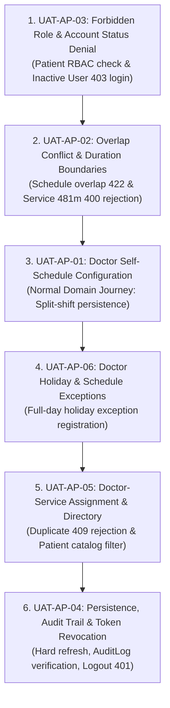

# CPE334 Lab 6: User Acceptance Testing (UAT) Plan & Test Execution Specification

* **Product Name:** Appointly (Clinic Appointment & Scheduling Management System)
* **Product Team:** **TH-017** (2 auan — Kamonnat Seetakhai 67070501001, Benyapha Rattanakunodom 67070501030)
* **Independent UAT Team:** **TH-045_P2** (EquipFlow — Norawit 67070501026, Pawarisa 67070501032)
* **Assessed Release Scope:** Sprint 1 Engineering Contracts (`F-001` through `F-007` per `DEC-017` Baseline)
* **Assessed Main Release Commit:** `6b73bfdbf029343e4af3268d72e9364fbab12f52`
* **Sprint 1 Release Tag:** `v0.1.0-sprint1` (`9808f9657a4200f5dddf49412a276fc874ff4175`)
* **Cloud Platform:** Google Cloud Platform (GCP) — Shared Course Project (`cpe-se-course-2026`)
* **Target Region:** `asia-southeast1`
* **Active Cloud Run Service:** `s96ba5182`
* **Deployed Live URL:** `https://s96ba5182-ddqo5fpv2a-as.a.run.app`
* **Local Test Baseline:** Port `3000` (Web + API) or `5173` (Vite) / `4000` (Express)

---

## 1. Document Overview & Lab 6 Context

This document constitutes the formal **User Acceptance Test (UAT) Handoff Package and Execution Specification** for **Appointly Sprint 1**, prepared by **Product Team TH-017** for independent execution and acceptance verification by **Independent UAT Team TH-045_P2 (EquipFlow)** in accordance with **CPE334 Lab 6 (Part A: UAT Preparation & Handoff)**.

### 1.1 Purpose of Independent User Acceptance Testing
UAT asks the central software engineering question: **"Can somebody else verify and accept it?"**
The objective is to provide an external engineering team with an unambiguous, executable test plan that evaluates delivered software behavior against the agreed **Sprint 1 Software Requirements Specification (SRS)** and **Acceptance Criteria (AC)** without requiring verbal explanation or code inspection.

### 1.2 Handshake & Team Details
| Responsibility | Team ID | Application | Team Members & Student IDs |
| :--- | :--- | :--- | :--- |
| **Product Team (Author)** | `TH-017` | **Appointly** (Clinic Scheduling) | Kamonnat Seetakhai (`67070501001`)<br>Benyapha Rattanakunodom (`67070501030`) |
| **Independent UAT Team (Tester)** | `TH-045_P2` | **EquipFlow** (Lab Equipment) | Norawit (`67070501026`)<br>Pawarisa (`67070501032`) |

---

## 2. Assessed Scope & Sprint Boundaries

Testing must strictly evaluate functionality delivered in **Sprint 1**. Features scheduled for future sprints are not part of this acceptance gate.

### 2.1 Implemented & Accepted Sprint 1 Scope (`F-001` to `F-007`)
1. **`F-001` Authentication & Role-Based Access Control (RBAC):**
   * Multi-role login (`POST /api/v1/auth/login`) with Argon2id password verification.
   * `HttpOnly; SameSite=Strict` cookie session issuance (`access_token`, `refresh_token`).
   * Authenticated identity resolution (`GET /api/v1/auth/me`).
   * Login rate limiting (5 consecutive failures per IP/email trigger cooldown).
   * Inactive account rejection (`403 Forbidden` `ACCOUNT_INACTIVE`).
   * Secure session termination & token revocation (`POST /api/v1/auth/logout`).
2. **`F-002` Patient Profile Management:**
   * Patient self-service profile inspection (`GET /api/v1/patients/me`) and modification (`PUT /api/v1/patients/me`).
   * Data validation: mandatory full name, Thai mobile format (`0[689]\d{8}`), past Date of Birth (`dateOfBirth < CURRENT_DATE`).
   * Administrative patient directory list (`GET /api/v1/admin/patients`).
3. **`F-003` Doctor Profile Management:**
   * Administrative doctor profile onboarding (`POST /api/v1/admin/doctors`) with atomic `User` + `Doctor` creation.
   * Doctor directory listing for patients (`GET /api/v1/doctors` returning only `profile_status = 'ACTIVE'`).
   * Doctor activation/deactivation (`PATCH /api/v1/admin/doctors/:id/status`) with audit trail.
4. **`F-004` Medical Service Catalog:**
   * Administrative service creation & configuration (`POST /api/v1/admin/services`).
   * Service duration constraint bounds (`1 <= duration_minutes <= 480`).
   * Public/Patient active service catalog view (`GET /api/v1/services`).
   * Service status toggle (`PATCH /api/v1/admin/services/:id/status`).
5. **`F-005` Doctor-Service Assignment (Cross-Entity Journey):**
   * Administrative assignment of medical services to doctors (`POST /api/v1/admin/doctors/:id/services`).
   * Duplicate assignment prevention (`409 Conflict` `DUPLICATE_ASSIGNMENT`).
   * Dynamic patient directory filtering by service (`GET /api/v1/doctors?serviceId=UUID`).
6. **`F-006` Doctor Self-Schedule Management (Primary Domain Journey):**
   * 7-day weekly schedule builder (`PUT /api/v1/doctors/me/schedule`) supporting split shifts (e.g. morning and afternoon shifts).
   * Immediate schedule persistence and retrieval (`GET /api/v1/doctors/me/schedule`).
   * Schedule overlap conflict detection (`422 Unprocessable Entity` `INVALID_SCHEDULE_WINDOW`).
   * Date-specific schedule exceptions (`POST /api/v1/doctors/me/exceptions`) for holidays and custom hours.
7. **`F-007` Clinic Settings & Schedule Governance:**
   * Public clinic metadata retrieval (`GET /api/v1/settings/public`).
   * Administrative clinic policy governance (`PATCH /api/v1/admin/settings`): clinic name, IANA timezone (`Asia/Bangkok`), booking start interval (`15` min), cancellation cutoff (`24` hr).
   * Centralized audit logging (`AuditLog` entity with Admin user ID and UTC timestamp).

### 2.2 Deferred Scope (Out of Scope for Sprint 1 UAT)
* **Patient Self-Registration & Password Recovery (`FR-001`, `FR-005`):** Deferred to Sprint 2 (`DEC-017`). Sprint 1 operates exclusively on reproducible synthetic accounts.
* **Appointment Slot Generation & Patient Booking (`F-008`–`F-013`):** Planned for Sprint 2. Any UI links to "Book Appointment" or "My Appointments" render standard **Coming Soon** placeholders.
* **Automated Notifications & Operational Reports (`F-014`–`F-019`):** Planned for Sprint 3.

---

## 3. Test Accounts & Private Delivery Policy

In accordance with course security guidelines, passwords and cryptographic secrets are **never committed to Git or printed in submission PDFs**. Credentials are distributed privately via secure team channels.

### 3.1 Pre-seeded Synthetic Account Directory
All accounts are provisioned via idempotent database seeding (`server/prisma/seed.ts`):

| Account Label | Role | Seed Email | Description & Purpose in UAT |
| :--- | :---: | :--- | :--- |
| `ADMIN_USER` | `ADMIN` | `admin@appointly.local` | Clinic Administrator. Has full privileges over clinic settings, services, doctors, and assignments. |
| `DOCTOR_USER` | `DOCTOR` | `doctor@appointly.local` | Primary Doctor (Dr. Somchai Prasert, General Practice, License: `MD-10001`). Used for self-schedule management and split-shift tests. |
| `DOCTOR_SEC` | `DOCTOR` | `doctor.somchai@appointly.local` | Secondary Doctor (Dr. Somchai Prasert (Lead), Internal Medicine, License: `MD-10002`). Used for cross-doctor schedule isolation. |
| `PATIENT_USER` | `PATIENT` | `patient@appointly.local` | Primary Patient (Arisa Wongsuwan). Used for profile management, catalog browsing, and RBAC boundary tests. |
| `PATIENT_SEC` | `PATIENT` | `patient.arisa@appointly.local` | Secondary Patient. Used for ownership isolation and directory tests. |
| `INACTIVE_USER` | `PATIENT` | `inactive@appointly.local` | Deactivated Account (`account_status = 'INACTIVE'`). Used for negative authentication boundary tests. |

> [!IMPORTANT]
> **Private Shared Password:**
> All test accounts in the evaluation environment share the standard test credential:
> **`<ChangeMe123!>`** *(or as notified in private team chat)*.
> *Do not commit this password to Git or include it in final report PDFs.*

---

## 4. Execution Rules & Sequencing Guidelines

To ensure deterministic test execution and prevent data collisions where one test invalidates preconditions for another, the UAT Team **must execute test cases in the recommended order below**.



### 4.1 Recommended Execution Order
1. **1st: `UAT-AP-03` (Forbidden Role & Inactive Account Denial):**
   Execute negative RBAC and inactive login rejection first while administrative configurations and schedules remain at baseline.
2. **2nd: `UAT-AP-02` (Schedule Overlap & Duration Boundary Validation):**
   Verify that invalid inputs (overlapping hours, 481-min duration) are cleanly rejected without altering baseline state.
3. **3rd: `UAT-AP-01` (Doctor Self-Schedule Split-Shift Management):**
   Execute the primary Sprint 1 normal domain journey, establishing clean working shifts for `DOCTOR_USER`.
4. **4th: `UAT-AP-06` (Doctor Holiday & Schedule Exception Management):**
   Add a date-specific override on top of the schedule established in `UAT-AP-01`.
5. **5th: `UAT-AP-05` (Doctor-Service Assignment & Patient Catalog Filter):**
   Assign medical services to `DOCTOR_USER`, verify duplicate assignment rejection (`409 Conflict`), and verify filtered visibility from `PATIENT_USER`.
6. **6th: `UAT-AP-04` (State Persistence, Audit Trail & Session Revocation):**
   Update clinic settings as `ADMIN_USER`, verify persistence across browser hard refresh, inspect database audit trail, and verify complete session cookie invalidation upon logout.

### 4.2 Test Reset & Cleanup Procedure
If a test run encounters unexpected data or if the UAT team wishes to perform a clean re-test:
* **Option A (Self-Service via Cloud Job):** If granted Cloud Shell access, execute `gcloud run jobs execute s96ba5182-migrate --wait --project cpe-se-course-2026`.
* **Option B (Coordinator Ping):** Simply send a message to Product Team TH-017 in the chat: *"Please reset database for Appointly UAT"*. The Product Team will execute the scoped seed reset script within 3 minutes and confirm readiness.

---

## 5. Executable UAT Test Cases

### 5.1 Case Category Mapping Matrix

| Case ID | Category (Lab 6 Spec) | Primary Feature & Linked AC | Primary Actor |
| :--- | :--- | :--- | :--- |
| **`UAT-AP-01`** | **Normal Domain Journey** | `F-006` Doctor Self-Schedule (`AC-F006-01`, `AC-F001-01`) | `DOCTOR_USER` |
| **`UAT-AP-02`** | **Business-Rule & Boundary Case** | `F-006` Overlap Conflict & `F-004` Service Bounds (`AC-F006-02`, `AC-F004-03`) | `DOCTOR_USER`, `ADMIN_USER` |
| **`UAT-AP-03`** | **Forbidden Role / Ownership Case** | `F-001` RBAC & `F-002` Profile Isolation (`AC-F001-03`, `AC-F001-04`, `AC-F002-02`) | `PATIENT_USER`, `INACTIVE_USER` |
| **`UAT-AP-04`** | **State, History & Persistence Case** | `F-007` Settings Persistence & `F-001` Token Revocation (`AC-F007-01`, `AC-F001-01`) | `ADMIN_USER` |
| **`UAT-AP-05`** | **Cross-Entity Assignment Journey** | `F-005` Doctor-Service & `F-003` Directory Filter (`AC-F005-01`, `AC-F005-02`, `AC-F003-02`) | `ADMIN_USER`, `PATIENT_USER` |
| **`UAT-AP-06`** | **Date Exception & Override Case** | `F-006` Schedule Exceptions (`AC-F006-03`) | `DOCTOR_USER` |

---

### Detailed Test Specifications

---

#### Case ID: `UAT-AP-01` — Doctor Self-Schedule Split-Shift Configuration
* **Category:** Normal Domain Journey (Primary Sprint 1 Feature)
* **Linked Specifications:** `F-006`, `AC-F006-01`, `AC-F001-01`, `STS-S1-008`
* **Purpose:** Verify that an authenticated doctor can manage weekly working hours, configure valid split shifts (morning and afternoon windows for lunch break) without error, and verify immediate persistence.
* **Actor & Role:** `DOCTOR_USER` (`doctor@appointly.local`)
* **Preconditions:** `DOCTOR_USER` is seeded and active in PostgreSQL.
* **Synthetic Inputs:**
  * Day of Week: **Monday** (`dayOfWeek: 1`)
  * Shift 1 (Morning): `09:00:00` to `12:00:00` (`isActive: true`)
  * Shift 2 (Afternoon): `13:00:00` to `17:00:00` (`isActive: true`)

**Numbered User Actions:**
1. Navigate to `https://s96ba5182-ddqo5fpv2a-as.a.run.app/login` in Google Chrome.
2. Enter email `doctor@appointly.local` and password `<ChangeMe123!>`, then click **Sign In**.
3. Verify automatic redirection to `/doctor/schedule` with top navigation showing "Dr. Somchai Prasert (DOCTOR)".
4. On the **Weekly Working Hours** builder, locate **Monday**.
5. Ensure two shift windows are defined:
   * First window: Start `09:00`, End `12:00`.
   * Click **+ Add Shift** (or configure existing split shift).
   * Second window: Start `13:00`, End `17:00`.
6. Click **Save Schedule** button.
7. Open Browser DevTools Console (F12) and run the following verification snippet:
   ```javascript
   // Verify persisted schedule via REST API
   fetch('/api/v1/doctors/me/schedule', { credentials: 'include' })
     .then(r => r.json())
     .then(res => {
       const mondayShifts = res.data.weeklySchedules.filter(s => s.dayOfWeek === 1);
       console.log("=== UAT-AP-01 MONDAY SHIFTS ===");
       console.table(mondayShifts.map(s => ({
         day: "Monday",
         start: s.startTime,
         end: s.endTime,
         active: s.isActive
       })));
     });
   ```

**Expected Results:**
* **UI:** A success notification banner ("Weekly schedule updated successfully") appears. No conflict error is displayed.
* **API / Console:** `PUT /api/v1/doctors/me/schedule` returns HTTP `200 OK`. The console table displays exactly 2 Monday shifts: `09:00:00 - 12:00:00` and `13:00:00 - 17:00:00`.
* **Evidence to Capture:** Screenshot showing the Doctor Schedule Manager with Monday split shifts saved, browser URL bar visible, and DevTools console output table.

---

#### Case ID: `UAT-AP-02` — Schedule Overlap Conflict & Service Duration Boundaries
* **Category:** Business-Rule & Boundary Case
* **Linked Specifications:** `F-006`, `F-004`, `AC-F006-02`, `AC-F004-03`, `STS-S1-008`, `STS-S1-006`
* **Purpose:** Verify that the system strictly prevents overlapping shift windows on the same day (`422 Unprocessable Entity`), rejects inverted times (`endTime <= startTime`), and rejects medical service duration outside `1..480` minutes (`400 Bad Request`).
* **Actor & Role:** `DOCTOR_USER` (`doctor@appointly.local`) and `ADMIN_USER` (`admin@appointly.local`)
* **Preconditions:** Authenticated as `DOCTOR_USER` for Schedule check; authenticated as `ADMIN_USER` for Service duration check.
* **Synthetic Inputs:**
  * Overlapping Monday Shifts: `09:00 - 13:00` and `12:00 - 16:00` (1-hour overlap `12:00–13:00`).
  * Inverted Shift: `16:00 - 10:00`.
  * Out-of-bounds Service Duration: `481` minutes (boundary violation: max allowed is 480).

**Numbered User Actions:**
1. While logged in as `DOCTOR_USER` at `/doctor/schedule`, modify Monday shifts:
   * Shift 1: `09:00` to `13:00`.
   * Shift 2: `12:00` to `16:00`.
2. Click **Save Schedule**.
3. Observe validation feedback on UI.
4. Execute API verification in DevTools Console (F12):
   ```javascript
   // Test overlapping schedule rejection via API
   fetch('/api/v1/doctors/me/schedule', {
     method: 'PUT',
     headers: { 'Content-Type': 'application/json' },
     credentials: 'include',
     body: JSON.stringify({
       shifts: [
         { dayOfWeek: 1, startTime: '09:00:00', endTime: '13:00:00', isActive: true },
         { dayOfWeek: 1, startTime: '12:00:00', endTime: '16:00:00', isActive: true }
       ]
     })
   }).then(async r => {
     const body = await r.json();
     console.log("=== UAT-AP-02 SCHEDULE OVERLAP RESULT ===");
     console.log("Status Code:", r.status);
     console.log("Error Code :", body.code || body.error?.code);
     console.log("Message    :", body.message || body.error?.message);
   });
   ```
5. Log out, then log in as `ADMIN_USER` (`admin@appointly.local`).
6. Navigate to `/admin/services` and test boundary duration via DevTools Console (F12):
   ```javascript
   // Test upper boundary violation (481 minutes)
   fetch('/api/v1/admin/services', {
     method: 'POST',
     headers: { 'Content-Type': 'application/json' },
     credentials: 'include',
     body: JSON.stringify({
       serviceName: 'Extreme Procedure Test',
       description: 'Exceeds maximum allowable duration',
       durationMinutes: 481
     })
   }).then(async r => {
     const body = await r.json();
     console.log("=== UAT-AP-02 SERVICE DURATION BOUNDARY ===");
     console.log("Status Code:", r.status);
     console.log("Response   :", body);
   });
   ```

**Expected Results:**
* **Doctor Schedule Overlap:**
  * **UI:** An error alert banner appears: "Schedule windows cannot overlap on the same day". Existing valid schedule remains unchanged in PostgreSQL.
  * **Console / API:** HTTP status `422 Unprocessable Entity` with error code `INVALID_SCHEDULE_WINDOW`.
* **Admin Service Duration Boundary:**
  * **Console / API:** HTTP status `400 Bad Request` rejecting `481` minutes. The service is NOT created.
* **Evidence to Capture:** Screenshot showing the UI conflict alert banner and DevTools Console with HTTP `422` and `400` responses.

---

#### Case ID: `UAT-AP-03` — Role-Based Access Control (RBAC) Denial & Account Isolation
* **Category:** Forbidden Role / Ownership Case
* **Linked Specifications:** `F-001`, `F-002`, `F-007`, `AC-F001-03`, `AC-F001-04`, `AC-F002-02`, `STS-S1-003`, `STS-S1-001`
* **Purpose:** Verify that unauthorized roles (e.g. `PATIENT`) are strictly prevented from accessing administrative portals or endpoints (`403 Forbidden`), cannot query other patients' records, and that deactivated accounts (`INACTIVE`) cannot authenticate.
* **Actor & Role:** `PATIENT_USER` (`patient@appointly.local`) and `INACTIVE_USER` (`inactive@appointly.local`)
* **Preconditions:** Seeded accounts exist in database.
* **Synthetic Inputs:**
  * Unauthorized Patient attempting administrative endpoints (`/admin/*`, `/api/v1/admin/settings`).
  * Inactive user credentials (`inactive@appointly.local` with `<ChangeMe123!>`).

**Numbered User Actions:**
1. Clear browser cookies/storage or open an Incognito window.
2. Attempt to log in with the deactivated account:
   * Email: `inactive@appointly.local`
   * Password: `<ChangeMe123!>`
   * Click **Sign In**.
3. Verify rejection on UI and inspect Console output.
4. Log in with active patient account: `patient@appointly.local` / `<ChangeMe123!>`.
5. After landing at `/patient/services`, manually type administrative URLs into the browser address bar:
   * Navigate to `https://s96ba5182-ddqo5fpv2a-as.a.run.app/admin/settings`
   * Navigate to `https://s96ba5182-ddqo5fpv2a-as.a.run.app/admin/doctors`
6. Observe client-side route guard redirection.
7. Open DevTools Console (F12) and verify authoritative backend RBAC rejection via API call:
   ```javascript
   // Attempt administrative mutation using Patient session
   fetch('/api/v1/admin/settings', {
     method: 'PATCH',
     headers: { 'Content-Type': 'application/json' },
     credentials: 'include',
     body: JSON.stringify({ clinicName: 'Unauthorized Name Mutation' })
   }).then(async r => {
     const body = await r.json();
     console.log("=== UAT-AP-03 PATIENT PRIVILEGE ESCALATION RESULT ===");
     console.log("Status Code:", r.status);
     console.log("Error Code :", body.code || body.error?.code);
     console.log("Message    :", body.message || body.error?.message);
   });
   ```

**Expected Results:**
* **Inactive Account:** Login is rejected with an error alert: "Account is inactive. Please contact administration." Backend returns HTTP `403 Forbidden` (`ACCOUNT_INACTIVE`).
* **UI Redirection:** Navigating directly to `/admin/*` as `PATIENT` immediately redirects to `/unauthorized` displaying "Access Denied: You do not have permission to view this page".
* **Backend RBAC:** `PATCH /api/v1/admin/settings` returns HTTP `403 Forbidden` with error code `FORBIDDEN`. Protected database state is unaltered.
* **Evidence to Capture:** Screenshot of `/unauthorized` access denial page with DevTools Console displaying HTTP `403 Forbidden`.

---

#### Case ID: `UAT-AP-04` — State Persistence, Audit Trail & Token Revocation
* **Category:** State, History & Persistence Case
* **Linked Specifications:** `F-007`, `F-001`, `AC-F007-01`, `AC-F001-01`, `STS-S1-009`, `STS-S1-001`
* **Purpose:** Verify that clinic configuration updates persist across browser restarts and hard refreshes, trigger an authoritative `AuditLog` entry, and that user logout completely revokes session tokens and cookies.
* **Actor & Role:** `ADMIN_USER` (`admin@appointly.local`)
* **Preconditions:** Authenticated as `ADMIN_USER`.
* **Synthetic Inputs:**
  * Updated Clinic Name: `Appointly Executive Care Centre`
  * Fixed Start Interval: `15` minutes
  * Cancellation Cutoff: `24` hours
  * Timezone: `Asia/Bangkok`

**Numbered User Actions:**
1. Log in as `ADMIN_USER` (`admin@appointly.local`).
2. Navigate to `/admin/settings` (**Clinic Settings**).
3. Change **Clinic Name** to `Appointly Executive Care Centre`.
4. Ensure **Booking Slot Interval** is `15` minutes and **Cancellation Cutoff** is `24` hours.
5. Click **Save Settings**.
6. Observe success notification toast.
7. Perform a hard browser refresh (**Ctrl+F5** / **Cmd+Shift+R**).
8. Inspect fields on `/admin/settings` to verify persisted values.
9. Verify public settings persistence via DevTools Console (F12):
   ```javascript
   // Query public clinic settings endpoint
   fetch('/api/v1/settings/public')
     .then(r => r.json())
     .then(res => {
       console.log("=== UAT-AP-04 PERSISTED PUBLIC SETTINGS ===");
       console.log("Clinic Name    :", res.data.clinicName);
       console.log("Timezone       :", res.data.timezone);
       console.log("Slot Interval  :", res.data.fixedStartIntervalMinutes, "mins");
       console.log("Cutoff Hours   :", res.data.cancellationCutoffHours, "hrs");
     });
   ```
10. Click the **Logout** button in the top navigation bar.
11. In DevTools Console (F12), test token revocation by requesting the identity endpoint:
    ```javascript
    // Verify session cookies and refresh token have been revoked
    fetch('/api/v1/auth/me', { credentials: 'include' })
      .then(async r => {
        console.log("=== UAT-AP-04 POST-LOGOUT VERIFICATION ===");
        console.log("Status Code (Expected 401):", r.status);
        console.log("Response:", await r.json());
      });
    ```

**Expected Results:**
* **Settings Persistence:** After hard refresh, `/admin/settings` displays `Appointly Executive Care Centre`. `GET /api/v1/settings/public` returns HTTP `200 OK` with the exact updated name.
* **Audit Trail:** An `AuditLog` entry (`CLINIC_SETTINGS_UPDATED`) is recorded in PostgreSQL containing the Admin's `userId` and UTC timestamp.
* **Logout Revocation:** User is redirected to `/login`. Session cookies (`access_token`, `refresh_token`) are cleared. DevTools console confirms `GET /api/v1/auth/me` returns HTTP `401 Unauthorized`.
* **Evidence to Capture:** Screenshot showing the updated settings after hard refresh, followed by the DevTools console showing HTTP `401 Unauthorized` after logout.

---

#### Case ID: `UAT-AP-05` — Doctor-Service Assignment & Dynamic Patient Directory Filtering
* **Category:** Cross-Entity Domain Journey
* **Linked Specifications:** `F-005`, `F-003`, `AC-F005-01`, `AC-F005-02`, `AC-F003-02`, `STS-S1-007`
* **Purpose:** Verify that an administrator can link medical services to doctors, that duplicate assignments are rejected with `409 Conflict`, and that patients filtering by service see only qualified, active doctors.
* **Actor & Role:** `ADMIN_USER` (`admin@appointly.local`) and `PATIENT_USER` (`patient@appointly.local`)
* **Preconditions:** Seeded services ("General Consultation", "Comprehensive Health Checkup") and doctors exist.
* **Synthetic Inputs:**
  * Target Doctor: Dr. Somchai Prasert (`doctor@appointly.local`)
  * Target Service: "General Consultation"

**Numbered User Actions:**
1. Log in as `ADMIN_USER` and navigate to `/admin/doctors`.
2. Locate Dr. Somchai Prasert and click **Assign Services** (or open Services modal).
3. In DevTools Console (F12), capture doctor and service IDs and test duplicate rejection:
   ```javascript
   // Fetch doctor and service IDs
   Promise.all([
     fetch('/api/v1/doctors?status=ACTIVE', { credentials: 'include' }).then(r => r.json()),
     fetch('/api/v1/services', { credentials: 'include' }).then(r => r.json())
   ]).then(async ([docRes, srvRes]) => {
     const doc = docRes.data[0];
     const srv = srvRes.data[0];
     console.log(`Testing assignment: Doctor ${doc.fullName} (${doc.doctorId}) <-> Service ${srv.serviceName} (${srv.serviceId})`);
     
     // Attempt duplicate assignment
     const res = await fetch(`/api/v1/admin/doctors/${doc.doctorId}/services`, {
       method: 'POST',
       headers: { 'Content-Type': 'application/json' },
       credentials: 'include',
       body: JSON.stringify({ serviceId: srv.serviceId })
     });
     const body = await res.json();
     console.log("=== UAT-AP-05 DUPLICATE ASSIGNMENT CHECK ===");
     console.log("Status Code (Expected 409):", res.status);
     console.log("Response:", body);
   });
   ```
4. Log out, then log in as `PATIENT_USER` (`patient@appointly.local`).
5. Navigate to `/patient/services` (**Service Catalog**).
6. Click on **General Consultation** or click **View Available Doctors**.
7. Verify that `/patient/doctors?serviceId=...` opens, listing only doctors qualified for General Consultation.
8. Deactivated doctors (`profile_status = 'INACTIVE'`) are excluded.

**Expected Results:**
* **Duplicate Assignment Rejection:** Submitting an existing `(doctorId, serviceId)` pair returns HTTP `409 Conflict` with error code `DUPLICATE_ASSIGNMENT`.
* **Patient Filtered Directory:** Patient directory displays only doctors assigned to the specified service. Unassigned or inactive doctors are omitted.
* **Evidence to Capture:** Console output of HTTP `409 Conflict` duplicate check, alongside Patient Portal UI showing doctors filtered by service.

---

#### Case ID: `UAT-AP-06` — Doctor Holiday & Schedule Exception Overrides
* **Category:** Date-Specific Business Rule & Exception Case
* **Linked Specifications:** `F-006`, `AC-F006-03`, `STS-S1-008`
* **Purpose:** Verify that a doctor can register date-specific exceptions (such as full-day clinic holidays or partial unavailable blocks) that override regular recurring weekly hours.
* **Actor & Role:** `DOCTOR_USER` (`doctor@appointly.local`)
* **Preconditions:** `DOCTOR_USER` is logged in.
* **Synthetic Inputs:**
  * Exception Date: Upcoming holiday (e.g. `2026-12-25` or `2026-12-31`)
  * Exception Type: `HOLIDAY` (full-day block: `startTime = null, endTime = null`)
  * Reason: `New Year Holiday - Clinic Closed`

**Numbered User Actions:**
1. Log in as `DOCTOR_USER` and navigate to `/doctor/schedule`.
2. Locate the **Schedule Exceptions & Overrides** section below the weekly grid.
3. Click **+ Add Exception**.
4. In the modal:
   * Select Date: Future holiday (e.g. `2026-12-31`).
   * Select Type: **Holiday (Full Day)**.
   * Reason: `New Year Holiday - Clinic Closed`.
5. Click **Save Exception**.
6. In DevTools Console (F12), verify exception registration:
   ```javascript
   // Query doctor exceptions
   fetch('/api/v1/doctors/me/schedule', { credentials: 'include' })
     .then(r => r.json())
     .then(res => {
       console.log("=== UAT-AP-06 REGISTERED EXCEPTIONS ===");
       console.table(res.data.exceptions.map(e => ({
         date: e.exceptionDate,
         type: e.exceptionType,
         reason: e.reason,
         fullDay: e.startTime === null && e.endTime === null
       })));
     });
   ```

**Expected Results:**
* **UI:** The exception appears in the Exceptions table with a "Holiday" badge and specified reason.
* **API / Console:** `POST /api/v1/doctors/me/exceptions` returns HTTP `201 Created`. The DevTools table displays the new holiday exception with `fullDay: true`.
* **Evidence to Capture:** Screenshot of the Doctor Schedule Exception table with the new holiday row and DevTools console output table.

---

## 6. Execution Recording & Acceptance Template (For UAT Team TH-045_P2)

The Independent UAT Team should copy this section to record actual findings during testing.

### 6.1 UAT Execution Log Summary

| Case ID | Category | Tested Commit / Rev | Execution Date & Time | Tester Name & ID | Actual Result (`PASS` / `FAIL` / `BLOCKED`) | Evidence Ref ID |
| :--- | :--- | :---: | :---: | :---: | :---: | :---: |
| `UAT-AP-01` | Normal Journey | `6b73bfdb` | `YYYY-MM-DD HH:MM` | `[Tester Name]` | `[ PASS / FAIL ]` | `EV-UAT-01` |
| `UAT-AP-02` | Boundary / Business Rule | `6b73bfdb` | `YYYY-MM-DD HH:MM` | `[Tester Name]` | `[ PASS / FAIL ]` | `EV-UAT-02` |
| `UAT-AP-03` | Forbidden Role / RBAC | `6b73bfdb` | `YYYY-MM-DD HH:MM` | `[Tester Name]` | `[ PASS / FAIL ]` | `EV-UAT-03` |
| `UAT-AP-04` | State Persistence | `6b73bfdb` | `YYYY-MM-DD HH:MM` | `[Tester Name]` | `[ PASS / FAIL ]` | `EV-UAT-04` |
| `UAT-AP-05` | Assignment Journey | `6b73bfdb` | `YYYY-MM-DD HH:MM` | `[Tester Name]` | `[ PASS / FAIL ]` | `EV-UAT-05` |
| `UAT-AP-06` | Schedule Exception | `6b73bfdb` | `YYYY-MM-DD HH:MM` | `[Tester Name]` | `[ PASS / FAIL ]` | `EV-UAT-06` |

---

### 6.2 Defect Reporting Template (If Any Failures Occur)

If any test case fails, please file a defect report using this standardized schema:

```markdown
### Defect Report: [DEFECT-ID]
* **Product Team:** TH-017 (Appointly)
* **Reporting Tester:** [Tester Name, Student ID, Team TH-045_P2]
* **Tested Revision:** [e.g. s96ba5182-00001-xxx / commit 6b73bfdb]
* **Linked Test Case ID:** [e.g. UAT-AP-02]
* **Linked Sprint 1 AC:** [e.g. AC-F006-02]
* **Severity:** [ Critical (blocks acceptance) | Major (blocks acceptance) | Minor ]
* **Preconditions & Inputs:** [State of accounts and inputs used]
* **Steps to Reproduce:**
  1. ...
  2. ...
* **Expected Result:** [Expected behavior per Sprint 1 specification]
* **Actual Result:** [Observed failing behavior, HTTP status, or error code]
* **Supporting Evidence:** [Screenshot ID / Log snippet with URL bar visible]
```

---

### 6.3 Independent UAT Acceptance Sign-off (Part D)

*Only to be completed by Independent UAT Team TH-045_P2.*

* **Tested Application Version:** `Appointly Sprint 1 (commit 6b73bfdbf029343e4af3268d72e9364fbab12f52)`
* **Deployment URL:** `https://s96ba5182-ddqo5fpv2a-as.a.run.app`
* **Independent Testers:**
  1. Norawit (`67070501026`) — Team `TH-045_P2` (EquipFlow)
  2. Pawarisa (`67070501032`) — Team `TH-045_P2` (EquipFlow)
* **Acceptance Decision:**
  * [ ] **Accepted** — All Sprint 1 UAT cases executed and passed; zero release-blocking defects.
  * [ ] **Accepted with explicitly documented minor limitations** — Minor non-blocking findings accepted as known limitations.
  * [ ] **Not Accepted** — Unresolved critical/major defects remain.
* **Decision Rationale & Date:** `[To be signed and dated upon execution completion]`

---
*End of CPE334 Lab 6 Part A UAT Plan — Appointly (Team TH-017)*

